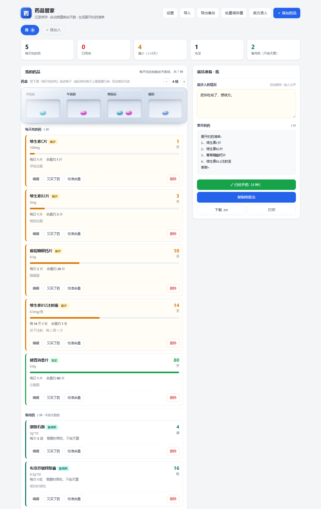
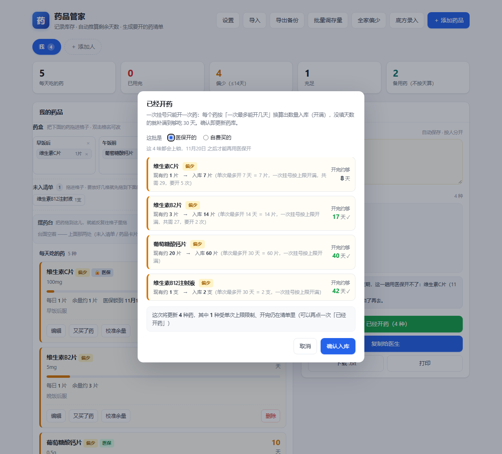
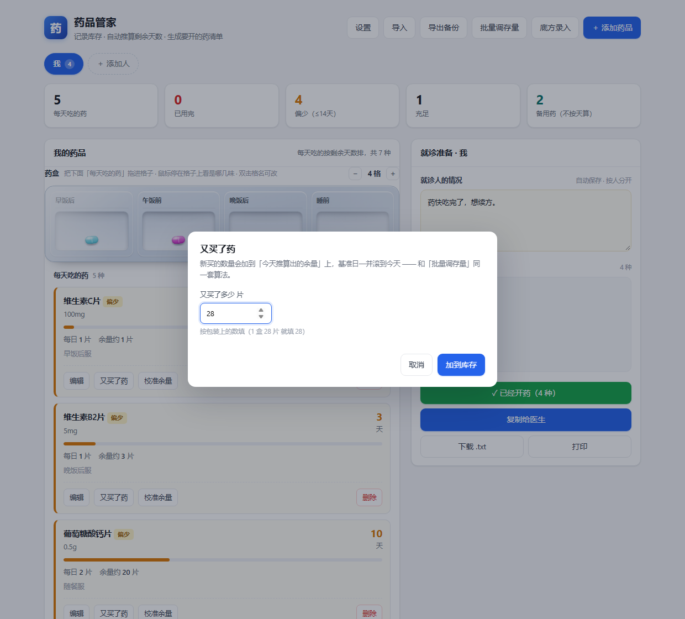
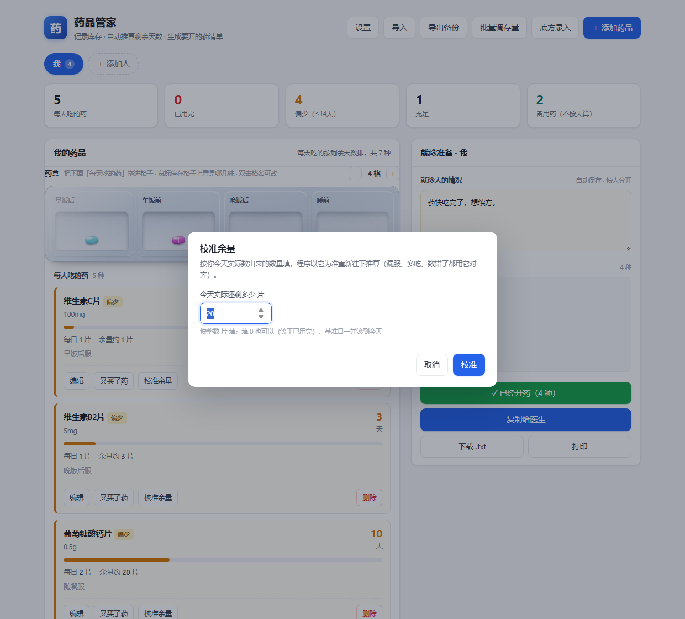
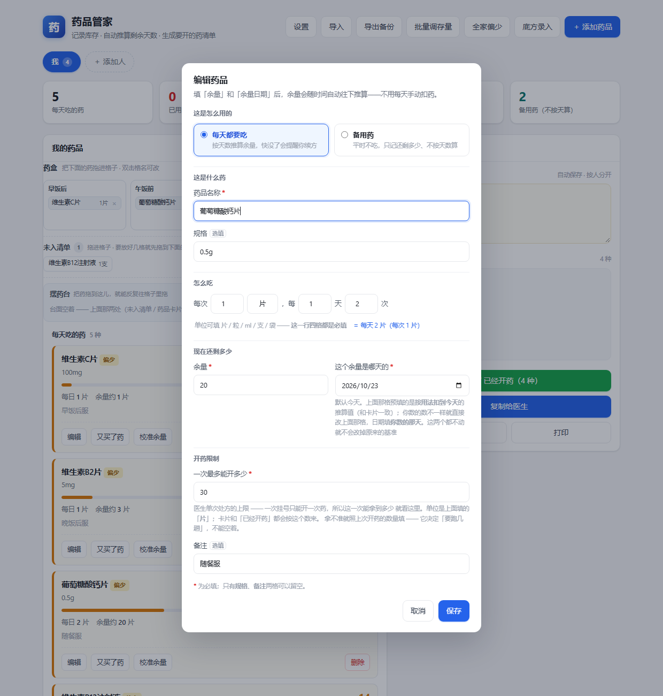
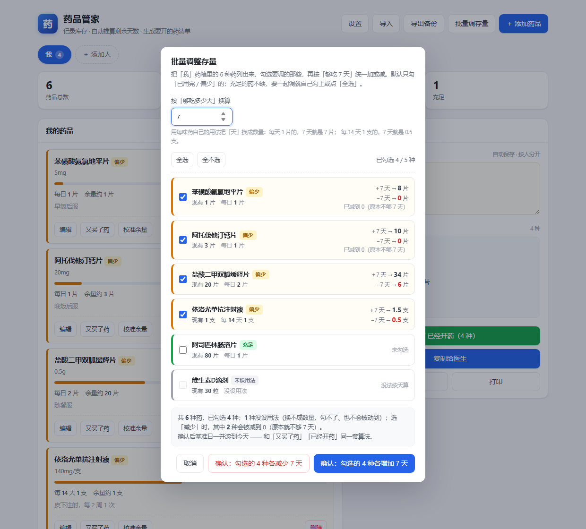
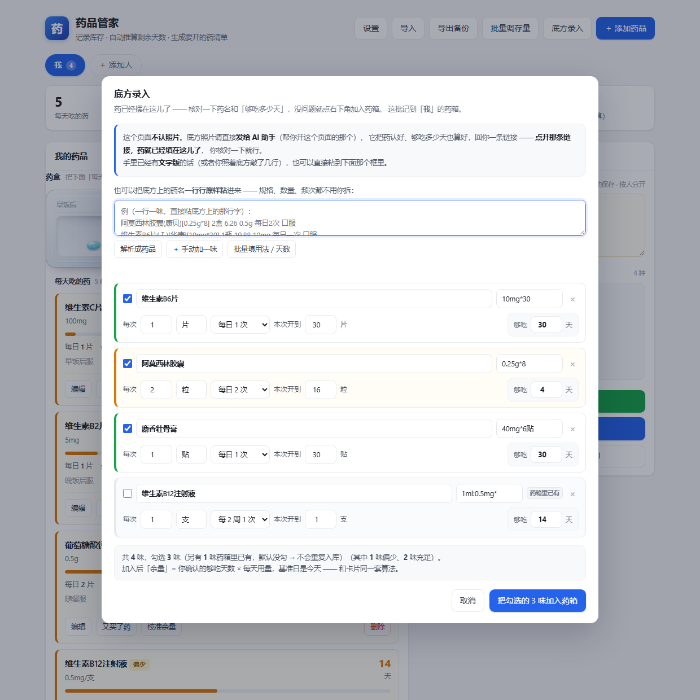

# 药品管家 drug-keeper

**在线试用** → <https://4dcf44c9286d4d28a2ba54368a33c7a4.app.workbuddy.host>

手机或电脑浏览器打开就能用，不用下载、不用装东西。
（把 `index.html` 存到本地双击打开也一样——那样连开页面都不用联网。）

**记一次库存，之后该开什么药、该开多少，它自己算。**

一个 HTML 文件，双击就开，不用装、不用联网、没有后端。数据只存在你自己的浏览器里。

给长期吃几种药的人用。尤其是**在互联网医院续方**的那种：每次都要在问诊框里手打一串药名，
少打一个医生就漏开一个，打完还得自己核对上次开了几盒、够不够吃到下次复诊。

这个程序把这件事翻过来：**先把家里有什么药、怎么吃记一遍，之后只顾着看颜色**。



---

## 它替你算三件事

| 算的 | 怎么算 |
|---|---|
| **还能吃到哪天** | 记录时填「余量 + 记到哪天」，之后每天自动往下推，卡片上直接写「剩 3 天」 |
| **要不要开** | 剩余天数 ≤ 你设的「偏少线」（默认 14 天），这张卡片就转黄并进右侧清单 |
| **这次开多少** | 按「一次最多能开多少」（单次处方限量）算；没填上限的就按「补满 N 天」倒推 |

算完的结果在右侧合成一段话 —— **就诊人的情况 + 要开的药清单**，一次复制，直接粘进问诊框：

```
药快吃完了，想续方。

要开的药清单：
1. 维生素C片
2. 维生素B2片
谢谢~
```



---

## 三档，一眼就够

卡片的档位只有三个词：**已用完 / 偏少 / 充足**。
不带「告急」「将尽」这类词 —— 天天看的东西，不想被自己的工具吓。

只有**一条线**：偏少线（默认「剩余 ≤ 14 天」，设置里可改）。
越过它，卡片转黄、进右侧清单、上面「偏少（≤14天）」的计数也加一 ——
界面各处说的都是同一个数，不会出现「设置里写 7、统计里写 14」这种自相矛盾。

**看到黄就该补药了**，要补多少是点「已经开药」时才看的细节，不摆在卡片上。

---

## 两种吃药节奏，都支持

| 节奏 | 怎么填 | 例子 |
|---|---|---|
| **每天吃** | 「每 **1** 天 **2** 次」 | 葡萄糖酸钙，随餐服用 |
| **隔 N 天一次** | 「每 **14** 天 **1** 次」 | 维生素B12注射液，两周打一支 |

间隔药有两个数容易混，程序分开算，也分开说：

| 问的 | 口径 | 维生素B12（每 14 天 1 支）余 2 支时 |
|---|---|---|
| **还剩几支** | 按周期**离散**扣——过几个周期就扣几次 | 2 支（永远是整数，不会出现「1.5 支」） |
| **够到哪天** | 按**平均**速率算——一支管两周 | 28 天（第 28 天才是下次该打的日子） |

这两种口径回答的是不同问题：一个问「手上还有多少」，一个问「能顶到哪天」。
所以间隔药在列表里显示的是**天数**，不是「还剩 1.5 支」这种会让人以为程序坏了的数。

---

## 「一次挂号只能开一次药」

续方时最容易漏的一环：**一种药可能一次开不够**。

所以每个药可以填「**一次最多能开多少**」。填了以后：

- 点「**已经开药**」→ 每个药**按它自己的上限入库**（没填上限的就补满到目标天数），
  界面上直接标出「开完约够 N 天」，够了的打勾；
- 被上限卡住、一次开不完的，当场写明「共需 X，要开 N 次」；
- 确认后一次更新整箱库存，并告诉你**还有几种没到位**，再点一次就行。

把「开了药 → 更新药箱」从 N 次点击压成 **1 次**。

---

## 库存变了怎么办：三个入口

现实里库存不是慢慢减的 —— 一次多买了、漏吃了几天、数了一遍发现对不上，都得手改。
三个入口的口径完全一致（都按「先按今天推算出现在剩多少 → 再改 → 基准日滚到今天」）：

| 场景 | 用哪个 |
|---|---|
| 就一种药又买了 / 开了药 | 卡片上的「**又买了药**」 |
| 数了一遍，和程序算的对不上 | 卡片上的「**校准余量**」，直接填数出来的数 |
| **一批药一起买的**（或一起漏吃了几天） | 顶部「**批量调存量**」 |

「又买了药」和「校准余量」都是**页面中间的弹窗**（不是浏览器自带那种小框）：
标题 + 一句话说明 + 输入框 + 取消/确定。**没有多余的对账行**，填完点按钮就行。
输入按 **1 片为单位**（不用管 0.25 那种半片的档位）。





> **卡片上和编辑弹窗里是同一个数**：点开「编辑」，那格「余量」预先填好的就是**按用法扣到今天**
> 之后还剩多少 —— 也就是卡片上「余量约 X」那个 X，不用自己做减法。
>
> 你当初数出来的**基准数和日期不会被偷偷改写** —— 只改备注、规格、用法这类别的项时，
> 保存会把原来的基准原样写回；只有当你**确实动了「余量」或它的日期**，才按你填的存、并把基准日滚到今天。



「批量调存量」是给「一次改一大片」用的：填一个天数，它**按每味药自己的用法**换算成数量 ——

- 弹窗里列出**全部药品**，**顺序和主页一模一样**（先按「已用完 → 偏少 → 充足 → 未设用法」，同档按剩余天数少的靠前）；
- 每行带**档位颜色**和标签，一眼看出哪些药快没了 —— 和主页卡片同一套配色；
- **挑着调**：每行一个勾选框，**默认只勾「已用完 / 偏少」的**（也就是真要补的那批）；
  充足的药不缺，默认不勾 —— 想连它一起调就自己勾上，或点「全选」；
  顶部有「全选 / 全不选」，右边一直显示「已勾选 N / M 种」，确认按钮上写的就是这个 N；
- 每天 1 片的，7 天 = 7 片；每天 2 片的，7 天 = 14 片；每 14 天 1 支的，7 天 = 0.5 支；
- 没填用法的药换不成数量，**勾不了**，行上直接写「没法按天算」，底部说明是哪几种；
- 选「减少」时减到 0 就停，**不会出现负库存**，被减到 0 的单独标出来；
- 弹窗里**同时列出「加」和「减」两个方向各会变成多少**，看清了再按按钮（不勾的行只写「未勾选」，不给数字）。



---

## 拍底方，一次录入整张处方

一次挂号常常开五六味药，一味一味手打很烦。顶部「**拍底方录入**」（空药箱时是「拍底方批量录入」）
就是为这个加的：

1. **拍下底方**（处方）—— 手机上点「拍 / 选照片」直接开相机。照片**只在你自己这块屏幕上**
   给你对照，不上传、不保存，关掉就没了；
2. 照着照片把药名一行行**原样粘/打**进来（或直接把电子处方的文字整段粘进来），
   点「解析成药品」。**整行粘就行，不用自己拆**：

   ```
   阿莫西林胶囊(康贝)[0.25g*8]  2盒  6.26  0.5g  每日2次  口服
   ↓
   药名 阿莫西林胶囊 · 规格 0.25g*8 · 每次 2 粒 · 每日 2 次 · 本次 16 粒 · 够吃 4 天
   ```

3. 程序按底方上的「数量 × 规格」和「频次」把**每味够吃多少天**算出来，摆在你面前让你确认 ——
   天数不对就直接改那格（改天数会自动反算「本次开到」，改它也会重算天数）；
4. 勾选要录的，点按钮一次入库。行色和主页卡片同一套：**已用完红 / 偏少琥珀 / 充足绿**。

它能认的东西：药名里的商品名括注（`(康贝)`）、规格里的每盒数量与包装单位（`40mg*6贴` → 每盒 6 贴）、
规格与用量之间的换算（`0.5g ÷ 0.25g = 每次 2 片`）、频次白话（每日 N 次 / 隔日 / 每周 / 每两周 / 每晚）、
用法（外用、皮下注射等写进备注）。**认不出来的字段会留默认值并明确提醒你去核对，绝不猜一个看起来很像的数** ——
药名认错是要吃错药的。



> **为什么不做自动识别？** 中文药品名的识别错一两个字，后果是吃错药。而这个程序是单文件、
> 零依赖、离线可用 —— 把几十兆的识别模型塞进来既拖慢打开速度，离线还用不了。

**还能再省一步**：这个页面支持**链接预填**。把底方照片交给 AI 助手，让它把认出来的药
编进一条 `#rx=…` 的链接发给你；点开链接，页面直接把弹窗摆好、药填好、天数算好，
核对一下点「加入药箱」就行。药名只编码在地址的 `#` 后面（浏览器**不会**把 `#` 之后的内容
发给服务器），但这串字符本身谁拿到谁能解开 —— 所以那条链接**只在自己人之间发**。
打开后页面会立刻抹掉链接里的这一段（免得刷新一次就重复入一次库），所以它**只能用一次**。
> 所以识别这一步**交给助手去做**：把底方照片发给助手，它认好字、算好天数，
> 给你一条带 `#rx=` 的链接；点开就是上面这个弹窗，药已经填好，核对一下点「加入药箱」就行。
> （链接里的数据是 Base64 放在 `#` 后面的，`#` 不会发给服务器，照片和数据都不出本机。）

---

## 多人分开记

每个家庭成员一个药箱，彼此独立，清单也分开出。
顶部点名字就切人，「就诊人的情况」也是按人存的、自动保存、关掉再打开还在。

---

## 数据在哪

**只在你这台机器的浏览器里**（`localStorage`），不上传、不联网、没有服务器。
换电脑或清了浏览器数据就用「**导出备份**」的 JSON 文件，在新机器上「导入」还原。

也正因为如此：**这个程序不判断你该不该吃药、也不推荐药品**。
它只是把你告诉它的用量算成天数和份数。开什么药、开多少，是医生的事。

---

## 项目结构

```
index.html            程序本体：单文件，拷走就能跑
_check/test_rxcap.py  自检脚本 —— 无头 Chrome 跑 205 项断言（口径、入库、文案、批量调存量、中间弹窗、底方解析、真药名自查）
_check/shot.py        重新生成 docs/ 里的截图
docs/                 README 用的截图
```

改完程序想自己验一遍：

```bash
python _check/test_rxcap.py
```

它会用无头 Chrome 打开一份临时副本（数据由脚本临时注入，不会写回 `index.html`），
把 205 条断言的通过情况打印出来，退出码非 0 就是有回归。

> 程序内**没有内置示例数据**，打开就是空药箱 —— 示例数据里带着病情描述，不该跟着代码分发。
>
> 同一件事还有一道**药名关**：`_check/_tmp_deny_names.txt` 是**本机专用、不进仓库**的一份
> 真实药名名单（被 `.gitignore` 挡着）。自检会拿它扫 `index.html` / `README.md` / `_check/*.py`，
> 扫到任何一条就报 FAIL —— 防止以后顺手把一段真处方原文粘进示例或测试夹具。
> 这份名单不跟着仓库走，clone 下来的人会自动跳过这条。

---

## 浏览器要求

任意现代浏览器（Chrome / Edge / Safari / 手机自带浏览器都行）。
不需要联网、不需要装任何东西。手机上可以用「添加到主屏幕」当 App 用。

---

## 许可

MIT（见 [LICENSE](LICENSE)）。
