# 药品管家 drug-keeper

**在线试用** → <https://4dcf44c9286d4d28a2ba54368a33c7a4.app.workbuddy.host>

手机或电脑浏览器打开就能用，不用下载、不用装东西。
（把 `index.html` 存到本地双击打开也一样——那样连开页面都不用联网。）

**记一次库存，之后该开什么药、该开多少，它自己算。**

一个 HTML 文件，双击就开，不用装、不用联网、没有后端。数据只存在你自己的浏览器里。

给长期吃几种药的人用。尤其是**在互联网医院续方**的那种：每次都要在问诊框里手打一串药名，
少打一个医生就漏开一个，打完还得自己核对上次开了几盒、够不够吃到下次复诊。

这个程序把这件事翻过来：**先把家里有什么药、怎么吃记一遍，之后只顾着看颜色**。

刚打开是空的，两个入口：**「添加第一种药」**一味一味地记，或者**「底方录入」**
拿一张处方把整页药一次记进来。

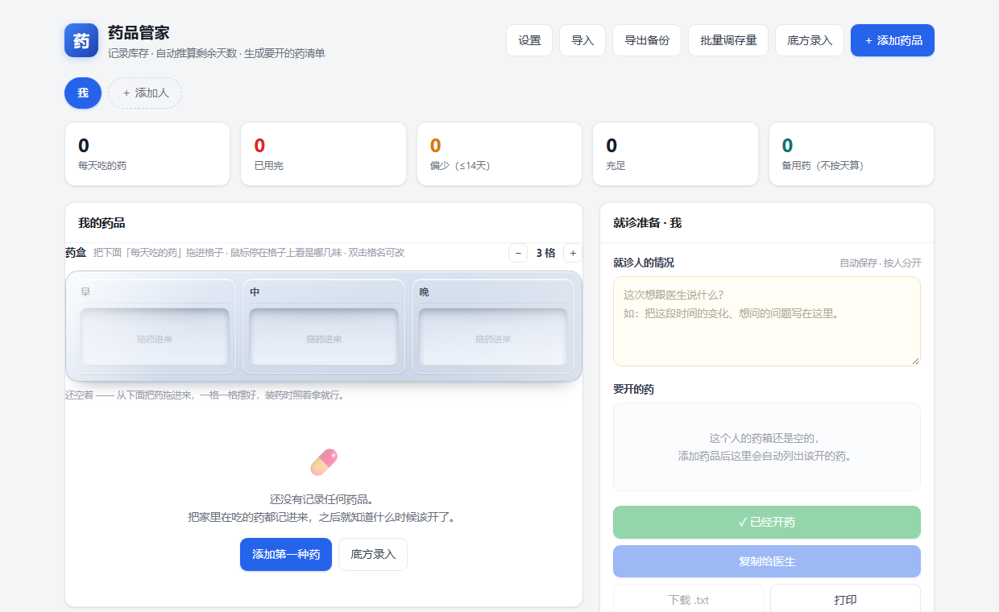

记完就是这样，之后只顾着看颜色：


药分两类，各算各的：**每天都要吃的**按天数往下推、快没了提醒你；
**备用药**（疼了才吃、外用、应急）不跟天数走，只记抽屉里还备着多少。
两类在清单上分两栏摆着，一眼分得清哪个数字是「天」、哪个数字是「片」。
再往后还有一层：用**医保**开回来的药会上一把锁，到能再开的前几天才解开 ——
免得白跑一趟医院（见「[医保开的药](#医保开的药锁一段时间)」）。

---

## 手机上：界面重新排过一遍

上面两张是电脑上的样子。手机屏幕窄得多，照搬会挤成一团：顶栏七个按钮换两行、
两栏并排拉成一条长龙、七格药盒每格不到 50px。所以宽度 ≤640px 时换成**另一套布局**：

| 电脑上 | 手机上 |
|---|---|
| 顶栏 7 个按钮平铺 | 只留品牌 +「⋯」，另外六个动词收进「⋯」菜单 |
| 统计 4 个一行 | 2×2，省下的高度留给药盒 |
| 两栏并排（药品 / 就诊准备） | 单栏，底部两个页签切换 |
| 「＋ 添加药品」在顶栏 | 右下角悬浮按钮（最高频的动作不该藏在菜单里） |
| 弹窗 560px 居中 | 左右各留 11px，内容长了能滚 |
| 表单一格两列 | 单列，输入框占满宽度 |

<p align="center">
  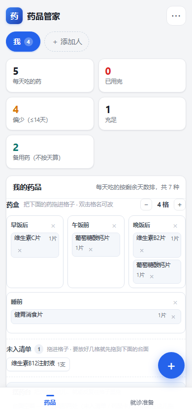
  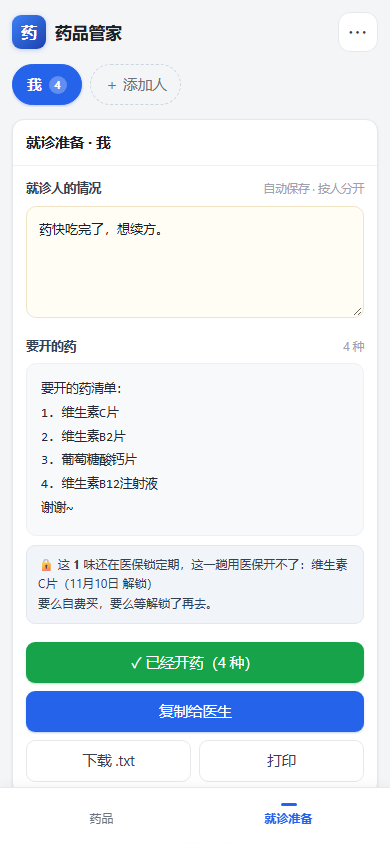
  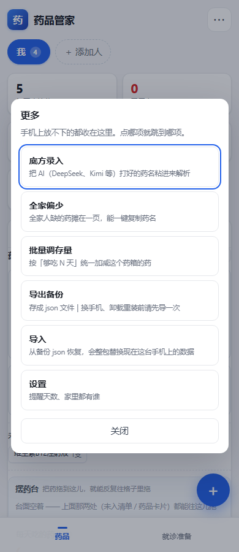
</p>

**电脑版一行没改** —— 整套手机布局都关在 `@media(max-width:640px)` 里，
宽度 ≥641px 时一条都不生效。自检里有一条专门盯这件事（桌面顶栏必须还是 7 个按钮、
那个「⋯」必须是隐藏的），免得哪天手机样式漏出来把电脑版顶歪。

**触屏拖拽**单独修过：手指一移动，浏览器先判断「这是不是要滚页面」，
一旦判成滚动就会发 `pointercancel`、同时停发 `pointermove` —— 药拖到一半就断，
看着像"拖不动"。现在改成在 `touchmove` 里按需挡：位移没到 6px 就放行让页面滚，
到了才 `preventDefault`。所以列表照常能用手指滑，同时药也拖得动。

---

## 它替你算三件事

| 算的 | 怎么算 |
|---|---|
| **还能吃到哪天** | 记录时填「余量 + 记到哪天」，之后每天自动往下推，卡片上直接写「剩 3 天」 |
| **要不要开** | 剩余天数 ≤ 你设的「偏少线」（默认 14 天），这张卡片就转黄并进右侧清单 |
| **这次开多少** | 按「一次最多能开几天」（单次处方限量）**换算**成数量；没填天数的就按「补满 N 天」倒推 |

算完的结果在右侧合成一段话 —— **就诊人的情况 + 要开的药清单**，一次复制，直接粘进问诊框：

```
药快吃完了，想续方。

要开的药清单：
1. 维生素C片
2. 维生素B2片
谢谢~
```


---

## 三档，一眼就够

卡片的档位只有三个词：**已用完 / 偏少 / 充足**。
不带「告急」「将尽」这类词 —— 天天看的东西，不想被自己的工具吓。

只有**一条线**：偏少线（默认「剩余 ≤ 14 天」，设置里可改）。
越过它，卡片转黄、进右侧清单、上面「偏少（≤14天）」的计数也加一 ——
界面各处说的都是同一个数，不会出现「设置里写 7、统计里写 14」这种自相矛盾。

**看到黄就该补药了**，要补多少是点「已经开药」时才看的细节，不摆在卡片上。

★ 这三档只数**每天吃的药** —— 它们都是拿「剩余天数」判出来的。备用药没有天数，
所以**不参与这三档**，在上面单独占一格（「备用药（不按天算）」）：
不然会出现「已用完 + 偏少 + 充足 ≠ 每天吃的药」这种算不回来的账。

---

## 备用药：不跟天数走

不是所有药都值得倒计时。布洛芬、蒙脱石散、外用软膏这类 —— 疼了才吃、吃不吃都不一定，
硬算「还能吃几天」算出来是假的，还会把「该续方」的清单搅乱。

所以这类药在添加时选**「备用药」**，程序就退一步，只回答一个问题：**还备着多少**。

| | 每天吃的药 | 备用药 |
|---|---|---|
| 卡片右上角写什么 | 剩 **N** 天 | 还剩 **N** 片 |
| 余量怎么变 | 按用法每天自动往下扣 | **不动**，只能手动改 |
| 会不会提醒续方 | 会（≤ 偏少线） | 不会 |
| 「已经开药」会不会带上它 | 会 | 不会 |
| 要填哪几格 | 名称 / 每次 / 单位 / 每几天 / 几次 / 余量 / 日期 / 开几天 | 名称 / 每次 / 单位 / 余量 / 余量日期 |

余量只有两个入口能动它：**「又买了药」**（往上加）和**「校准余量」**（直接改成你今天数出来的数）。
编辑弹窗里选了「备用药」，「每几天 / 几次」当场就收起来，「开药限制」那**一步**更是整个跳过 —— 那几格对它没有意义：

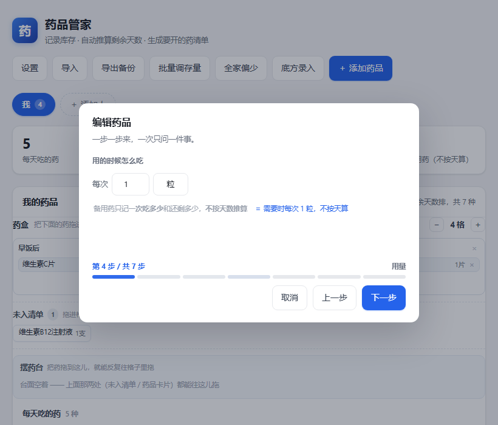

> 改主意了随时能换：同一味药在编辑里切「每天吃 ↔ 备用药」就行。
> 换的时候**屏幕上那个数就是新起点** —— 不会把那十几天已经吃掉的量重新算回库存，
> 也不会拿一个很久以前数的数重新按天倒扣。

---

## 药盒：今天这一格，该拿哪几片

库存回答的是「还剩几天」，但**装药那一刻要回答的是另一个问题**：
早晨那格该从哪个瓶子里各拿几粒？晚饭后那格又是哪几味？

所以主页顶上摆了个**模拟药盒**，格数自己定（1~7 格）。盒子下面跟两个区域 ——
**未入清单**（还没摆进任何一格的药）和**摆药台**（正摆在手上的药）：

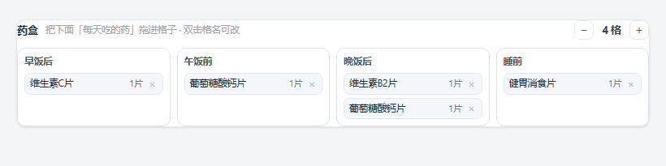

| 想干的事 | 怎么操作 |
|---|---|
| 改格数 | 药盒右边的 `−` / `＋`，1~7 格（只能从末尾增减） |
| 删某一格 | 格名右边那个 `×` —— **指定删哪一格**，不用为了删中间一格先减格再补回来。带药的会先问你一句 |
| 改格名 | **双击**格名，改成「早饭前」「早饭后」「睡前」这种 —— 格子叫什么你说了算 |
| 放药进去 | 从未入清单里**拖进**格子（鼠标按住药名拖，不是点按钮） |
| 放多格 | **一天三顿的药**：先把它拖到下面的**摆药台**，再从台面往各格拖 —— 拖几次都行，摆完点 `×` 收走 |
| 挪位置 | 从一格**拖到另一格** = 搬过去，不会凭空多出一份 |
| 拿出来 | 点药名后面的 `×`，或者**拖回未入清单** —— 只是从盒子里拿走，**药和库存都不动** |
| 减格子 | 被砍掉的那格要是还放着药，会先问你一句；药本身不会丢 |

> 两个 `×` 别混：**格名旁边**那个拆的是整格（里面的药会回到未入清单），
> **药名后面**那个只把这一味从这一格拿出来。删格和减格一样，药和库存都不动；
> 只剩一格时那个 `×` 是藏起来的（药盒至少要留一格）。

三个区域是**互补**的，同一味药只会出现在其中一处：

| 区域 | 放什么 | 怎么进去 | 怎么出来 |
|---|---|---|---|
| **药盒格子** | 摆好的 | 从清单 / 台面拖进来 | 点 `×` 或拖回清单 |
| **未入清单** | 还没碰的 | 自动（每天吃的药里没进盒的） | 拖进格子 / 拖上台面 |
| **摆药台** | 正摆在手上的 | 从清单或药品卡片拖上来 | 点 `×` 收走 |

> **摆药台为什么存在** —— 未入清单里的药拖一次进盒就从清单消失，一天要吃三顿的药
> 要放三格时，得滚回下面的药品列表再拖两次。台面就是把这个"再拖两次"搬到药盒旁边：
> 药先放上台面留一份，往几个格子各拖一次（每次都复制，台面不动），摆完点 `×` 收走。
> 它只是拖拽时的中转站，**不影响库存、不按天扣、也不写进任何统计**。

> **未入清单只列还没摆的** —— 摆进盒子（或放上台面）就从清单里消失
> （点 `×` 拿出来的、减格被清掉的，会自己回来）。
> 全部摆完之后那一行会写「每天吃的药都摆进盒子里了」，但落点还在，想从盒里往外拖照样拖得进去。
> 备用药不进盒，也就不在清单和台面上。

> **备用药拖不进药盒** —— 它不按天吃，塞进每日药盒会撒谎。想放的话先在「编辑」里改成每天吃的。

格子和摆放都**按人分开**存，切到别人就换一套；导出备份也一起带走，
换台电脑导入回来照旧。老存档没有这块，打开时自动补一个 3 格（早 / 中 / 晚）、台面空的。

> 药名一行放不下就折行（最多三行，再长才出省略号）。7 格是最窄的情形 ——
> 那时格子里只塞得下两个字，所以剂量和 `×` 会自动让到下一行，把整行宽度留给药名。

---

## 全家偏少：一趟把家里的药补齐

药不是一个人吃的。给自己看剩几天、再给爸妈看剩几天，得来回切人；
可买药偏偏是**全家一趟**办完的事。所以顶栏有个「全家偏少」，
把每个人药箱里「已用完」和「够吃 `提醒天数` 以内」的药摊在同一页，按人分组：

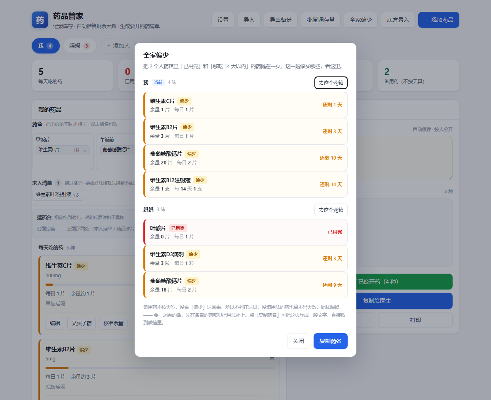

| 这页在干什么 | 说明 |
|---|---|
| 收哪些药 | 「已用完」+「够吃 `提醒天数` 以内」（天数跟着设置里那个提醒阈值走，默认 14 天）|
| 怎么排 | 按人分组；组内先「已用完」，再按剩余天数从少到多 |
| 每行右边 | 「已用完」或「还剩 N 天」 |
| 去这个药箱 | 直接切到那个人，关掉这页就能接着编辑 / 开药 |
| 复制药名 | 把这一页压成一段纯文字，粘到微信里发给家人 / 药店 |

「复制药名」出来的就是下面这个样子 —— 标题带日期和总数，按人分段、段内编号，
药名后头那个括号是紧迫度，方便对方先买急的：

```text
全家偏少的药（2026-10-23）：共 5 味
【我】
1. 维生素C片（还剩 1 天）
2. 维生素B2片（还剩 3 天）
【妈妈】
1. 叶酸片（已用完）
2. 维生素D3滴剂（还剩 3 天）
```

> 只有一个人时不写「【…】」分段，直接从编号开始；全家都不偏少时这个按钮是灰的。

> **备用药不列** —— 它不按天吃，没有「剩几天」这回事。
> **没填用法的也不列** —— 算不出天数，硬塞进来只会误导。这两条那页底部也写着。
> 只有一个人时，标题说明会自动改成「你药箱里…」，不会硬说「把 1 个人药箱里」。

---

## 全家汇总：几个人都有同一种药的时候

「全家偏少」只回答「这趟该买什么」。还有一个问题是它答不了的：

> 妈妈和我都在吃葡萄糖酸钙。我剩 20 片、她剩 20 片，可她是每天 1 片、我是每天 2 片 ——
> **开药的时候全家一共要开多少？改完总量，得先把快吃完的那个补上。**

人数**多于一**的时候，人员栏里「＋ 添加人」旁边会多出「全家汇总」。
它把全家的药**按药名合在一起**，一行一个药名，行下列出每人各多少、够几天，
**余量最少的那个挂一个小标**：

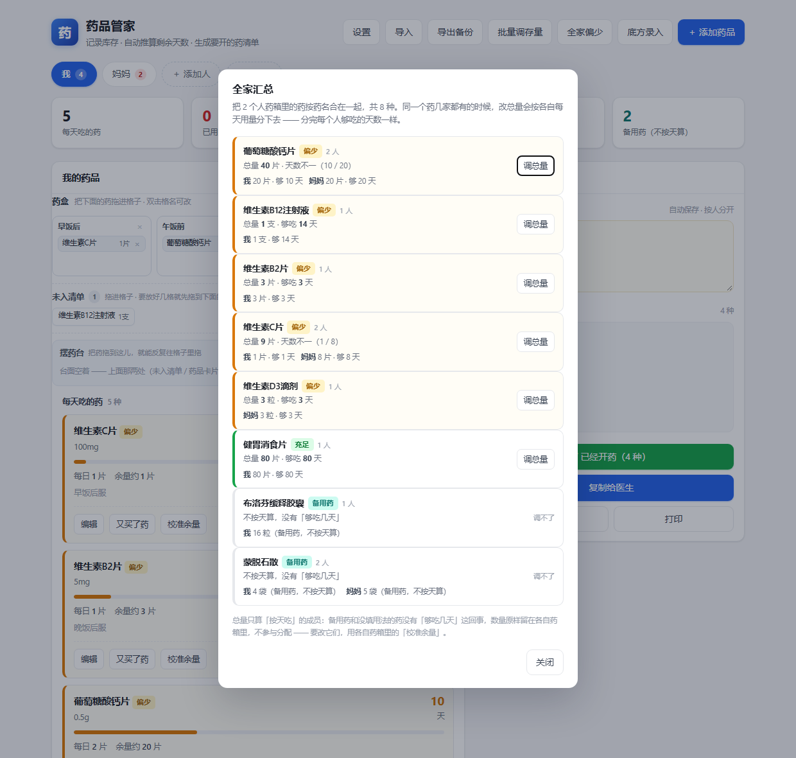

| 这页在干什么 | 说明 |
|---|---|
| 谁会出现 | 只在**人数 > 1** 时出现（一个人的时候这页就是药品列表，没有合并可言） |
| 合并口径 | **药名 + 单位**。同名的「片」和「粒」加不到一起，会分成两行 —— 宁可分开，不能加错 |
| 总量 | 只算「按天吃」的成员。备用药和没填用法的不并进来（它们没有天数） |
| 天数 | 几个人一样就写「都够吃 N 天」；不一样就如实写「天数不一（10 / 5）」，不拿平均数糊过去 |
| 行的颜色 | 取这几个人里**最急**的那一档 —— 有一个人已用完，这一行就是红的 |
| 调总量 | 点行右边的「调总量」，填**全家一共多少**（不是加减多少） |
| 谁分到 | 见下 |
| 调不了 | 两人都是备用药的那种药，行右边只写「调不了」—— 没有天数就没有"该补给谁"这回事 |

**分配规则（这是这一页的重点）：多的全给「余量最少」的那位。**

「余量」按**还能吃几天**算，不按片数 —— 每天吃 2 片剩 20 片（10 天）比每天吃 1 片剩 15 片（15 天）更急。
行明细里那个「余量最少」小标标的是谁，加的药就落在谁身上。

| 例子 | 甲（每天 1 片） | 乙（每天 2 片） | 全家总量 |
|---|---|---|---|
| 改之前 | 20 片 → 20 天 | 20 片 → 10 天 | 40 片 |
| 改成 50 片 | 20 片 → 20 天（不动） | **30 片 → 15 天** | 50 片 |
| 改成 25 片 | **5 片 → 5 天** | 20 片 → 10 天（不动） | 25 片 |

- **加药** → 多的量**全部**加到余量最少的那位头上，其余人一分不动
- **减药** → 从余量**最多**的那位开始扣，扣光再找下一位，谁都不会被扣成负数
- 天数并列时给排在前面那位（人员栏里的顺序）

> **为什么不把两个人的天数弄成一样** —— 这是开药场景：a 每天 2 片、b 每天 1 片，
> 硬按同一天数开，a 就会先不够吃。该补的是快吃完的那个人，不是"把两个人的进度拉齐"。
> 也别做「差额平摊」：吃得多的人多撑得更少，两个人的天数反而越拉越开。

> 分完之后基准日一并滚到今天 —— 和「校准余量」走同一套口径，屏幕上那个数就是新的起点。

> 只有一个人吃这个药时，改总量就等于直接改 TA 的余量（不用先切过去）。
> 备用药要改数量，还是回各自药箱用「校准余量」—— 这一页不碰它们。

---

## 每天吃的药：两种节奏，都支持

| 节奏 | 怎么填 | 例子 |
|---|---|---|
| **每天吃** | 「每 **1** 天 **2** 次」 | 葡萄糖酸钙，随餐服用 |
| **隔 N 天一次** | 「每 **14** 天 **1** 次」 | 维生素B12注射液，两周打一支 |

间隔药有两个数容易混，程序分开算，也分开说：

| 问的 | 口径 | 维生素B12（每 14 天 1 支）余 2 支时 |
|---|---|---|
| **还剩几支** | 按周期**离散**扣——过几个周期就扣几次 | 2 支（永远是整数，不会出现「1.5 支」） |
| **够到哪天** | 按**平均**速率算——一支管两周 | 28 天（第 28 天才是下次该打的日子） |

这两种口径回答的是不同问题：一个问「手上还有多少」，一个问「能顶到哪天」。
所以间隔药在列表里显示的是**天数**，不是「还剩 1.5 支」这种会让人以为程序坏了的数。

---

## 「一次挂号只能开一次药」

续方时最容易漏的一环：**一种药可能一次开不够**。

所以每个药都要填「**一次最多能开几天**」——「添加药品 / 编辑药品」里这一格是**必填**，
填的是**天数**，不是片数。

> **为什么按天填**：「最多开 30 天」是医生嘴里的话。要多少**片**得拿自己的用法乘一遍
> （规格、每天几次、每次几片，三处都能乘错），这一步交给程序做。
> 填完那格，下面紧接着就把换算写出来 ——「每天 2 片 × 30 天 ＝ 60 片」，
> 不用自己拿计算器核。换算的规则是：
>
> - 每天吃的：`天数 × 每天用量`（每天 2 片、30 天 → 60 片）
> - 隔天 / 隔周用的：按**整周期向下取整**，不超上限
>   （每 14 天 1 支、限 30 天 → **2 支**＝28 天，不会写 2.14 支）
> - 上限比一个周期还短（写 7 天、其实两周打一支）：至少给**一次的量** ——
>   药拆不开，给 0 支等于这味药永远开不了

填了以后：

- 点「**已经开药**」→ 每个药**按它自己的上限入库**，
  界面上直接标出「开完约够 N 天」，够了的打勾；
- 被上限卡住、一次开不完的，当场写明「单次最多开 7 天 ＝ 7 片 …… 共需 30，要开 5 次」；
- 确认后一次更新整箱库存，并告诉你**还有几种没到位**，再点一次就行。

> 从**底方录入**直接进来的药还没填过上限（历史上记的是「不限」）：那种药在「已经开药」里
> 会**补满到目标天数**。点开「编辑药品」补一个天数就行 —— 那格会空着并提示
> 「原来是不限，请填一个上限」。
>
> **老版本的存档不用管**：以前那格填的是**片数**，打开编辑时会按你现在的用法换算成天
> 显示出来（60 片 ÷ 每天 2 片 → 30），存下去才变天数。只是打开看一眼不动它，存档里那个数
> 一个字都不改 —— 换算除不尽的话，偷偷改掉就意味着上限变了。

把「开了药 → 更新药箱」从 N 次点击压成 **1 次**。

---

## 医保开的药：锁一段时间

医保有个绕不开的规矩：**同一味药，得隔一段时间才能再开**。
所以每味药还要记一笔 —— 这批是**自费买的**，还是**医保开的**。

凡是"往药箱里加药"的地方都会问这一句：

| 在哪加 | 怎么选 |
|---|---|
| 添加药品 / 编辑药品 | 「这笔药怎么来的」：自费买的 / 医保开的（选医保时填开药日） |
| 又买了药 | 数字下面那一行：自费买的 / 医保开的 |
| 底方录入 | 顶上总开关（默认医保），**外加每行一个**小标 —— 单独哪味不一样就点它翻过来 |
| 已经开药 | 默认按医保记（本来就是去医院开的动作），想记自费可以改 |

> **校准余量**、**批量调存量**不问来源：它们只把库存数字改对，不算一次开药，锁不动。

医保的那几味，药名旁边挂一把锁：

- 锁着：`🔒 医保`，下面一行写「医保锁到 11月20日（还有 23 天）」
- 到日子自己开：小标变成绿色的「医保」，写「医保 · 已经可以再开」

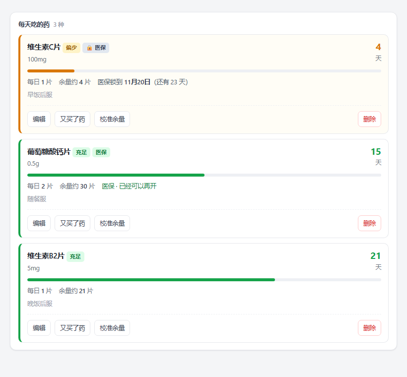

### 两个天数，都在设置里填

各地政策不一样，所以这两个数不写死在程序里：

| 设置项 | 意思 | 默认 |
|---|---|---|
| 医保开药间隔（天） | 用医保开过之后，这么多天内不能再开同一味 | 30 |
| 提前几天解锁 | 离"能再开"还剩这么多天时，锁先打开 —— 好提前挂号线 | 7 |

**锁到哪天 = 开药日 + 间隔 − 提前**。按默认值，今天用医保开了一味，**第 23 天**解锁。

改这两个数，**所有药上的锁一起跟着变** —— 换了个地方、政策调了，改一次就够。

### 为什么锁是"算"出来的

存档里只记**开药日**和"这是医保开的"，不记"锁没锁"：

- 日期一过自己就开，不需要每天跑什么定时任务；
- 中间十几天没打开页面，再打开也是对的，不会漏解；
- 点开编辑看一眼再保存，锁不会因为你按了一下「保存」就重置到今天。

### 自费补货不动锁

锁着的时候去药店自费买一瓶，锁**还是锁着** —— 自费买药不是"又用医保开了一次"。
自费的也不会把「医保」这个标记抹掉：它记的是这味药上一次是不是走医保。

### 它也会提醒你

- 「要开的药」下面：锁着的那几味单独一句「这一趟用医保开不了」，附上哪天解锁；
- 「全家偏少」：锁着的行带 🔒，点「复制药名」出去的**文字里也写着**「医保锁到 X月X日」——
  照着买的人才不会白跑一趟。

> **老存档不用管**：没有这个标记的药一律当**自费**，不上锁。

---

## 填表：一次只问一件事

添加一味药要交代的东西不少：叫什么、什么规格、怎么吃、还剩多少、一次能开几天、自费还是医保……
一口气全摆在一屏里，人一看就头大，还容易漏填（漏了会在保存时被一次性打回，更烦）。

所以**凡是"要填好几项"的表，都改成了引导式**：一次只问一件事，填完点「下一步」蹦出下一个，
底下一条进度栏 —— 只有分段图形，不写「第 1 步 / 共 8 步」这种字：亮到第几段就是在第几步，
一眼的事，不必再读一句话。

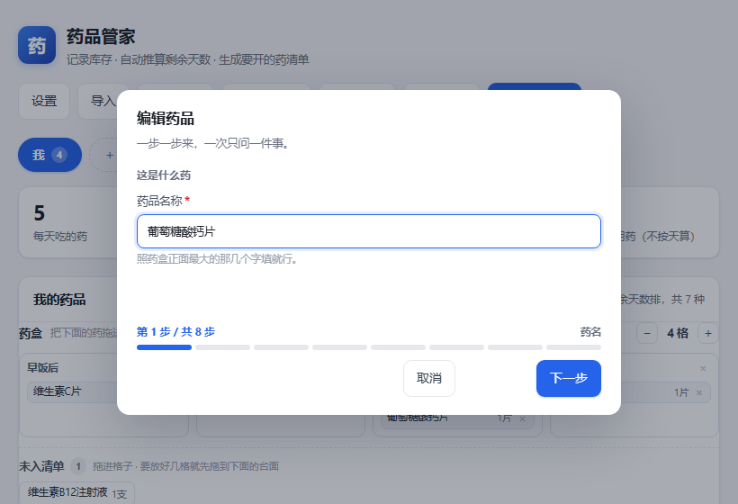

三条规矩：

- **进度栏点得动** —— 每一小段就是一步，点哪段跳哪段。编辑一味老药只想改个备注，
  不用从第一步一路点过去；
- **这一格没填对，就不往下走**：红字写在格子下面，不弹窗、不打断。
  这样"错在哪"永远只在这一步里，不用翻回前面找；
- **回车 = 下一步**，不会一不小心把整张表提交了。

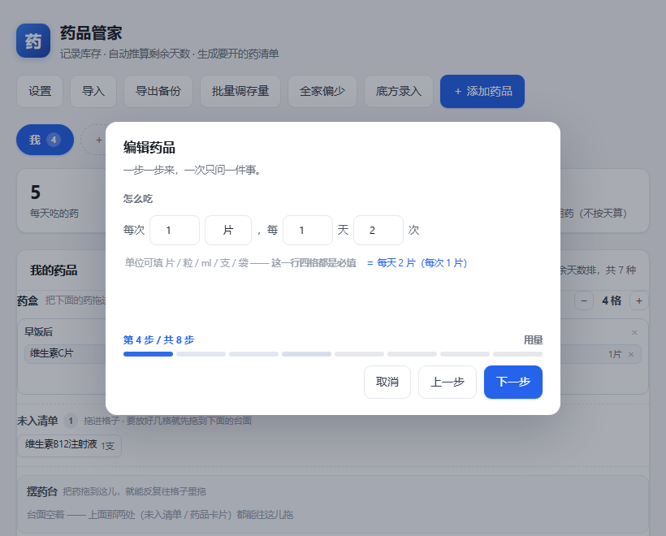

哪几张表是引导式的：

| 表 | 几步 |
|---|---|
| 添加 / 编辑药品（每天吃） | **8 步**：药名 → 规格 → 怎么用 → 怎么吃 → 还剩多少 → 开药几天 → 自费/医保 → 备注 |
| 添加 / 编辑药品（备用药） | **7 步** —— 没有「开药几天」，那一步整步跳过，不是灰着让人点 |
| 又买了药 | **2 步**：买多少 → 自费还是医保 |
| 校准余量 | **1 步**（只有一格，进度栏就不出现了，按钮直接写「校准」） |
| 设置 | **5 步**：偏少线 → 补货目标 → 医保间隔 → 提前解锁 → 家庭成员 |

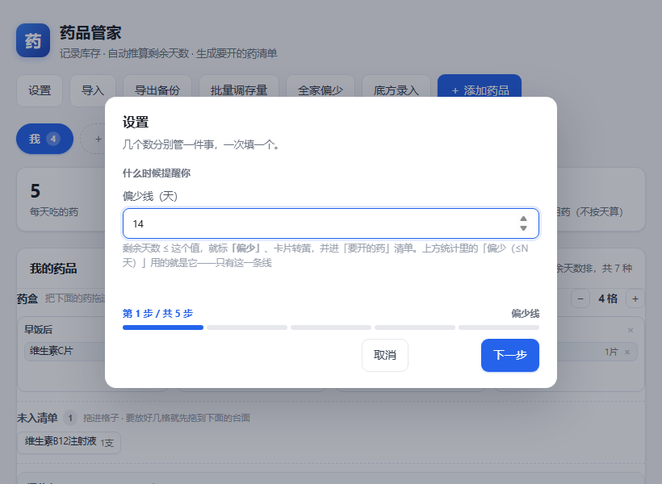

> **"一步"= 一个问题，不是一个输入框。**
> `每次 [2] [片]，每 [1] 天 [1] 次` 是一句话，拆开看反而看不懂，所以放在同一步；
> 而「药名」和「规格」是两个问题，就分成两步。选填的那几步（规格、备注）直接点「下一步」跳过即可。
>
> 表单**没有变成两套**：拆的只是"露哪一块"，字段名、必填、存档、备份导入全都还是原来那一套 ——
> 所以你以前的存档、导出的备份，在引导式里一字不差地对得上。

---

## 库存变了怎么办：三个入口

现实里库存不是慢慢减的 —— 一次多买了、漏吃了几天、数了一遍发现对不上，都得手改。
三个入口的口径完全一致（都按「先按今天推算出现在剩多少 → 再改 → 基准日滚到今天」）：

| 场景 | 用哪个 |
|---|---|
| 就一种药又买了 / 开了药 | 卡片上的「**又买了药**」 |
| 数了一遍，和程序算的对不上 | 卡片上的「**校准余量**」，直接填数出来的数 |
| **一批药一起买的**（或一起漏吃了几天） | 顶部「**批量调存量**」 |

「又买了药」和「校准余量」都是**页面中间的弹窗**（不是浏览器自带那种小框）：
标题 + 一句话说明 + 输入框。**没有多余的对账行**，填完点按钮就行。
输入按 **1 片为单位**（不用管 0.25 那种半片的档位）。

「又买了药」是两步：先填**买了多少**，再问**这笔是自费还是医保**（见上面「[填表](#填表一次只问一件事)」）。
「校准余量」只有一格，一步就完 —— 它本来就不是一次买药，所以不问来源。


> **卡片上和编辑弹窗里是同一个数**：点开「编辑」，那格「余量」预先填好的就是**按用法扣到今天**
> 之后还剩多少 —— 也就是卡片上「余量约 X」那个 X，不用自己做减法。
>
> 你当初数出来的**基准数和日期不会被偷偷改写** —— 只改备注、规格、用法这类别的项时，
> 保存会把原来的基准原样写回；只有当你**确实动了「余量」或它的日期**，才按你填的存、并把基准日滚到今天。
>
> **哪些格必须填**（指**每天吃的药**）：药名、每次用量、单位、每几天、每周期几次、余量、余量日期、一次最多能开几天
> ——**这 8 格必填**（带红色 `*`），只有「**规格**」「**备注**」两格选填。
> 这 8 格分散在引导式的 6 步里（见「[填表](#填表一次只问一件事)」），
> 哪一步没填对就在哪一步说，不会攒到最后一次性打回。
> 每次用量、每周期几次填 0 会被拦下（0 等于没填用法，卡片就算不出「剩几天」）；
> 余量可以填 0（刚好吃完），但不能空着。
>
> 选了「**备用药**」就只剩 4 格必填：药名、单位、余量、余量日期 ——
> 「每几天 / 几次」对它没有意义，会当场收起来；「开药限制」更是**整步跳过**，
> 也**不会**拿这几格拦你。


「批量调存量」是给「一次改一大片」用的：填一个天数，它**按每味药自己的用法**换算成数量 ——

- 弹窗里列出**全部药品**，**顺序和主页一模一样**（先按「已用完 → 偏少 → 充足 → 未设用法」，同档按剩余天数少的靠前，**备用药排在最后**）；
- 每行带**档位颜色**和标签，一眼看出哪些药快没了 —— 和主页卡片同一套配色；
- **挑着调**：每行一个勾选框，**默认只勾「已用完 / 偏少」的**（也就是真要补的那批）；
  充足的药不缺，默认不勾 —— 想连它一起调就自己勾上，或点「全选」；
  顶部有「全选 / 全不选」，右边一直显示「已勾选 N / M 种」，确认按钮上写的就是这个 N；
- 每天 1 片的，7 天 = 7 片；每天 2 片的，7 天 = 14 片；每 14 天 1 支的，7 天 = 0.5 支；
- 没填用法的药换不成数量，**勾不了**，行上直接写「没法按天算」；备用药同理，写「备用药，不按天算」；
- 选「减少」时减到 0 就停，**不会出现负库存**，被减到 0 的单独标出来；
- 弹窗里**同时列出「加」和「减」两个方向各会变成多少**，看清了再按按钮（不勾的行只写「未勾选」，不给数字）。


---

## 底方录入：页面只认文字，照片得先过一个 AI

一次挂号常常开五六味药，一味一味手打很烦。顶部「**底方录入**」（空药箱里也摆了一个）就是为这个加的。

**这个页面不认照片，页面上也没有藏着一个「后台 AI」** —— 你看到的就是这个网页，
它不会偷偷把照片送去什么地方认字。认字这一步得**你自己找个 AI** 来干：
DeepSeek、Kimi、豆包，都行，就是你平时聊天那个窗口。

1. 点弹窗里的「**复制提示词**」，连着底方照片一起发给 AI（提示词已经把格式定死了，你不用自己交代）；
2. 它回你的那段文字**整段复制**，粘进弹窗里的框；
3. 点「**解析成药品**」，把每一味的**药名、用量、够吃多少天**逐个核对一遍，再入库。

**要是那个 AI 能直接给你一条 `#rx=…` 链接**（页面里藏着一份写给 AI 的说明，愿意配合的读一眼就懂），
点开也行 —— 弹窗直接摆好、药填好、天数算好，连粘都不用。两条路最后落到同一个弹窗。

**整行粘就行，不用自己拆**：

```
阿莫西林胶囊(康贝)[0.25g*8]  2盒  6.26  0.5g  每日2次  口服
↓
药名 阿莫西林胶囊 · 规格 0.25g*8 · 每次 2 粒 · 每日 2 次 · 本次 16 粒 · 够吃 4 天
```

行色和主页卡片同一套：**已用完红 / 偏少琥珀 / 充足绿**。
药录进来之后点「**批量填用法 / 天数**」，一次把每味药的吃法填完：上面一条「统一设置」把一样的
（每次几片 · 每日几次 · 开多少天）一次套到全部，下面逐味微调 —— 改天数会反算「本次开到」，
改它也会重算天数。

### 复制一段提示词，让 AI 照着格式回

**为什么非要有提示词**：AI 按自己的习惯回话，页面就读不懂。同一张底方，它可能回你——

```text
某某片［某厂］40mg×28片/盒，1盒 — 每次 40mg，每日一次，口服
```

逗号把「1 盒」和药名隔开，解析下来「本次开到 1 片」，五味药全变成**够吃 1 天**。
不是解析器笨 —— 这行字本身没有固定结构，人也要读两遍才知道哪段是数量。

所以弹窗里给了一段**可一键复制**的提示词。它要求 AI 把药夹在两个标记之间：

```text
[药单开始]
某某片(某厂)[40mg*24片] 1盒 10mg 每日一次 口服
某某胶囊[0.25g*12粒] 2盒 1粒 每日2次 口服
某某注射液[100mg/1mL] 1支 100mg 每两周一次 皮下注射
[药单结束]
```

一行一味，7 个位置，空格隔开，顺序固定：
**药名 / 商品名 / 规格 / 开几盒 / 每次用量 / 频次 / 用法**。

> **只看药本身，不问什么时候吃。** 提示词里没有「服药时间」这一栏，程序也不读 ——
> AI 顺手在末尾写个「早饭后」也不影响（解析前会把这几个字擦掉，因为它们会让
> 「每日2次」被误判成 1 次），但擦完就扔，不会拿它去建药盒。
> 药盒建几格、哪味药放哪一格，全部由你自己拖 —— 见下面「药盒」那一节。

| 为什么这么定 | |
|---|---|
| 要一对起止标记 | AI 总要在药单前后说几句话，靠关键词过滤挡不住（「我从照片上认出了 5 种药：」这句看着就像药名），有了标记就能**只取中间那段** |
| 字段顺序固定、空格分隔 | 解析器不用猜哪段是数量、哪段是规格。实测同一批药，按这个写总量 28 / 30 / 56 / 1 / 30、够吃 28 / 15 / 28 / 14 / 30 天，全对 |
| 规格写成 `[40mg*28片]` | 不带 `/盒`。带了也认（`片/盒` 会被剥成 `片`），但少一层歧义 |

**标记外的话不浪费**：AI 关于怎么吃、要注意什么的提醒照常写，页面只取标记中间那段，
那些话你照样能看。万一它忘了写结束标记，也不会整段丢 —— 取到末尾为止。

**没按格式写也不崩**：老写法（逗号、破折号、`×28片/盒`）照样能解析出 5 味药，
只是总量可能认错、得你手改。提示词是把「要改」变成「不用改」，不是唯一入口。

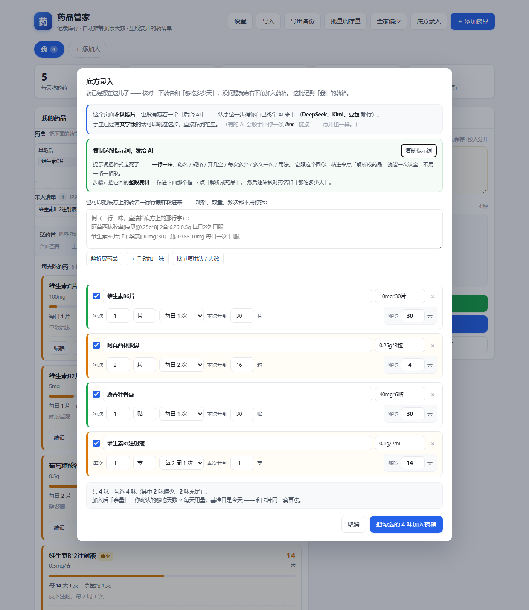

**入库之后，药都在「未入清单」里**。程序不替你建格、也不替你往里放 ——
建几格、每格叫什么、哪味药摆哪一格，都是你自己拖（操作见上面「药盒」那一节）。

一味药进哪一格，只有你知道：底方上写的是「每日一次」，但你是早饭吃还是睡前吃，
它不在纸上。这一格摆错，第二天早上照着盒子拿药就错了 —— 所以这一步留给人。

### 它认得准什么、认不准什么

**认得准的**：药名里的商品名括注（`(康贝)`）、规格里的每盒数量与包装单位（`40mg*6贴` → 每盒 6 贴）、
规格与用量之间的换算（`0.5g ÷ 0.25g = 每次 2 片`）、频次白话（每日 N 次 / 隔日 / 每晚 /
`每周2次` / `每两周一次` / `每月1次`）、用法（外用、皮下注射等写进备注）。
末了的「早饭后」「睡前」这类字会在解析前被擦掉 —— 不擦的话「每日2次 睡前服」
会被频次规则当成「每晚一次」，2 次就变成 1 次了。

**认不准就明说**：认不出来的字段留默认值并**明确提醒你去核对**，绝不猜一个看起来很像的数 ——
药名认错是要吃错药的，**不硬凑**。


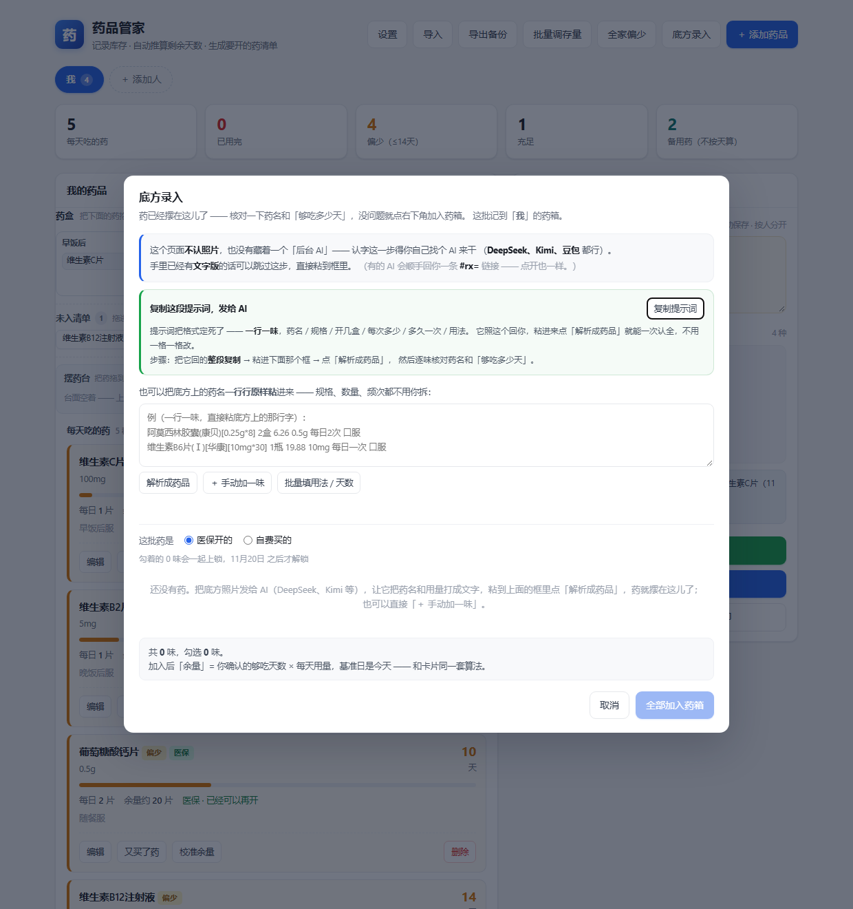

> **药名一律当草稿。** 不管是 AI 给的、还是你自己粘进来的，入库前都逐味核对一遍。

### 给 AI 的接口说明（页面里藏着一份）

页面里藏着一段**写给 AI 看的说明**（`index.html` 里的 `<script id="rx-agent-guide">` ——
平时不显示、也不会被执行）：它讲清了 `#rx=…` 链接怎么编、`rows` 每个字段是什么意思、
两条换算口径（每天用量、够吃天数），以及本机现成的解析工具。所以把照片丢给能读页面的 AI 时
**不用额外交代格式**，它读一眼就懂 —— 这是「点链接就填好」那条路能跑顺的关键。
而最通用的那条（让它吐一段文字）不需要任何说明，聊天窗口里说一句就够了。
页面上的按钮提示、空状态文案也都按这个口径写，用户不会以为「这页自己会认字」。

**里面还有三条「硬规矩」**（2026-10-13 加，起因是一次真事故）：
AI 把底方上的一味药**换成了另一个同类药**、同时又**漏掉一味真的** ——
药味总数还是原来的数，所以「N 种全部录入」那句自报**看上去是过的**，没人发现。
（**总数对得上 ≠ 认对了。**）所以说明里钉了三条：

1. **逐字照抄**：药名必须是底方纸上原样印着的那几个字，不许换成同类药 / 商品名 / "更常见的"，
   也不许自作主张"纠正"；认不清就留空让人补，别猜一个像样的。
2. **闭合校验要「按张」做，而且要交上来**：每张底方各数一遍药味（Σ = 条数）、**每张**各对一次账
   （Σ(数量×单价) = 那张的金额）。合起来对一次不算数 —— 单张各错一点能互相抵消，
   上面那次事故正是这么溜过去的。算完的结果**必须写进 `sheets` 一起交**（见下），
   在肚子里过一遍不算：页面会把它摆给用户看，你报不上来的，用户只会当成"没人替他核过"。
3. **这份底方是谁的（`patient`）**：姓名/性别/年龄/诊断/就诊日期必须从底方抬头**照抄**，
   不许按用户昵称猜。页面照它定位药箱 —— **抄错就记到别人名下了。**
   （键名用英文 `name` / `sex` / `age` / …，照抄中文抬头行页面取不到。）

### 对账依据：把「有没有人核过」变成看得见的

上面第 2 条规矩写在说明里，但**写着的规矩是会被跳过的** —— 那次事故就是这么发生的：
助理没做对账（或做了没说），页面也没问，于是"我认得对不对"全靠它自述一句"全部录入"，
没有任何东西能反驳它。所以现在 `#rx=` 的载荷里多了一个 **`sheets`**：

```
sheets = [ {i:1, n:2, amount:20.45,  sum:20.45},
           {i:2, n:1, amount:6.58,   sum:6.58},
           {i:3, n:5, amount:913.65, sum:913.65} ]
         i=第几张  n=这一张几味  amount=单据上的金额  sum=它自己算的 Σ(数量×单价)
```

弹窗顶上会多一条，逐张把账摊开 —— **对得上才标 ✓**：

```
AI 交了对账 ✓（3 张底方，共 8 味）
第 1 张：2 味 · ✓ 单据 20.45 元 = 算出来 20.45 元
第 2 张：1 味 · ✓ 单据 6.58 元 = 算出来 6.58 元
第 3 张：5 味 · ✓ 单据 913.65 元 = 算出来 913.65 元
```

三条底线，都是"**不许沉默**"：
- **对不上**（某张 `sum ≠ amount`，或各张味数加起来 ≠ 清单条数）→ 整条标红，
  直接写「**先别入库**：金额或行数对不上，说明这一批里必有药读错了（丢一味 / 编一味 / 数量单价读错）」；
- **没交 `sheets`** → 不能装作没事（沉默会被读成"没问题"），写明「那个 AI 没交对账依据 ——
  没人替你对过」，并请你自己对着照片数一遍；
- **金额读到 `null`** → 算"对不了账"，绝不冒充通过。

> **这一层能做什么、不能做什么**：页面手上没有照片，**验不了"读得准不准"**；它验的是
> AI **自报的数自不自洽**（行数、金额两笔账），并把结果**摆到人眼前**。真正的最后一道
> 还是人拿照片扫一眼 —— 但至少"有没有人核过"这件事，从此是看得见的，而不是靠一句自述。

为什么单挑「金额」当锚：它是一个数，比 N 行药名好读得多。把 N 行读数代进去算 Σ(数量×单价)，
**对不上 → 这 N 行里必有一行读错了**。把"读 N 行"压成"对 1 个数"，出错率就下来了。

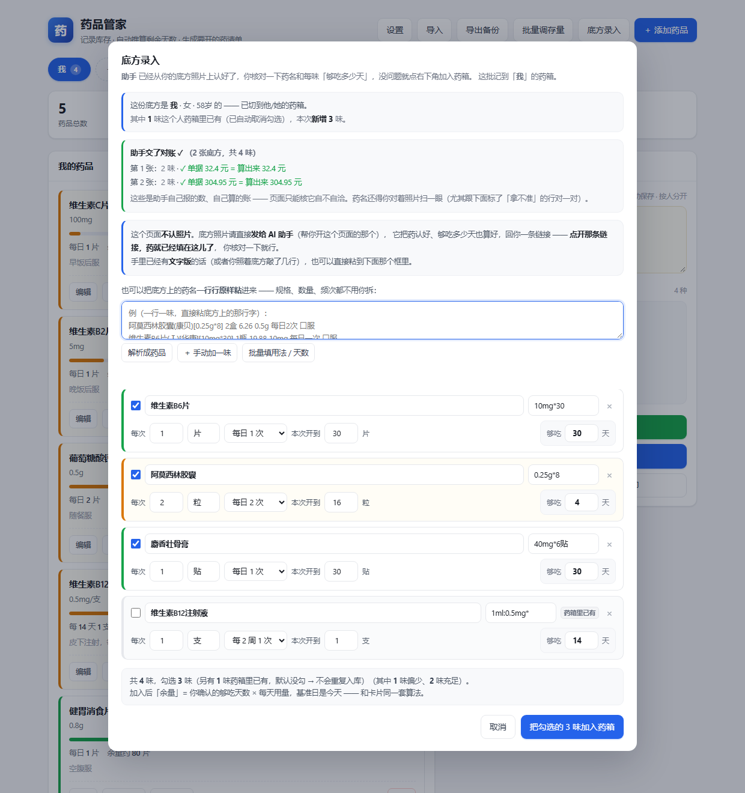

> 图里顶上两块：**「这份底方是谁的」**和**「AI 交了对账」**（逐张列出账）。
> 这两块**只在「AI 给的链接」那条路出现** —— 用户自己粘文字时没有"谁读的"这回事，
> 不会冒出来质问他"没人替你核过"（`rxWho` / `rxAudit` 都按这个口径挡了一道）。

### 两份底方（或同一份发第二遍）：重复的挑出来，只加新出现的

底方不是只录一次。复诊、换药、同一张重发都很常见，所以页面拿到 `#rx=` 里的药之后，
会先跟**这个人药箱里已有的药**比一遍（按药名比，规格不同也算同一味）：

- **已有的那几味照样列出来**（不偷偷删掉），但那行挂一枚「**药箱里已有**」角标、**默认不勾选**；
- **新出现的**那几味才是勾上的；
- 弹窗顶上写明「其中 N 味已有（已自动取消勾选），本次**新增 M 味**」；
- 全是重复的时候，确认按钮直接灰掉 —— 没有新的可加，不会白塞一遍。

> **为什么不让 AI 自己去重**：它看不到你药箱里有什么，它删掉的药就真的没了。
> 所以 AI 只管**照实把这一张底方上的药全列出来**，去重这件事由页面做（它才知道药箱里有什么）。

### 这份底方是谁的

弹窗顶上会写清这一份底方属于谁：「这份底方是 **某某 · 女 · 58岁** 的（某某医院 · 2026-10-12）·
诊断：…」。然后：

- 药箱里**有**叫这个名字的人 → 自动**切到他/她的药箱**再入库（不会记错人）；
- **没有**这个人 → 弹一句问你要不要新建一个（点取消就记在当前人名下，页面也会明说"没有新建人"）；
- 底方上**根本没写姓名** → **不乱猜也不换人**，但会提醒你「这些药记到当前『XX』名下，请自己确认是谁的」。

**链接预填怎么工作的**：药名只编码在地址的 `#` 后面（浏览器**不会**把 `#` 之后的内容
发给服务器），但这串字符本身谁拿到谁能解开 —— 所以那条链接**只在自己人之间发**。
打开后页面会立刻抹掉链接里的这一段（免得刷新一次就重复入一次库），所以它**只能用一次**。

### 想全在本地跑：`tools/rx_local/`

上面那条「交给 AI」的路，本机也能自己走 —— 用 **Windows 自带的 OCR 引擎**
（`Windows.Media.Ocr`，中文语言包系统里就有），不联网、不装服务：

```bash
pip install Pillow winrt-runtime winrt-Windows.Foundation \
    winrt-Windows.Foundation.Collections winrt-Windows.Media.Ocr \
    winrt-Windows.Graphics.Imaging winrt-Windows.Storage \
    winrt-Windows.Storage.Streams winrt-Windows.Globalization

python tools/rx_local/rx_local.py 处方照片.jpg            # 打印核对表
python tools/rx_local/rx_local.py 处方照片.jpg --json out.json
python tools/rx_local/rx_local.py 处方照片.jpg --url https://<线上地址>/   # 再给一条 #rx= 链接

# ★ 一次给多张（同一次就诊常常好几张单子）—— 它会**按张**对账，并把
#   patient（第 1 张的抬头）和 sheets（逐张的对账）一起塞进那条链接：
python tools/rx_local/rx_local.py 底方1.jpg 底方2.jpg 底方3.jpg --url https://<线上地址>/
```

输出长这样（拿一张手机拍的、躺着的小光圈照片试的，两味药）：

```
抬头：姓名=…  性别=…  金额=20.45
药名              规格        数量   每次   频次      够吃   备注
阿奇霉素片         0.5g*60    2盒    2片    每日2次    30天   口服
麝香壮骨膏         40mg*6贴   1盒    1贴    每日1次    6天    外用
交叉校验：Σ(数量×单价) = 20.45 元，单据上写 20.45 元 → 对得上 ✓

# 给多张时，末尾再加一段「按张对账」（合起来对会被互相抵消，所以必须逐张）：
按张对账（★ 必须逐张：合起来对一次账，单张各错一点会互相抵消）
  第 1 张：2 味 · 单据 20.45 = 算出来 20.45 → 对得上 ✓
  第 2 张：1 味 · 单据 6.58 = 算出来 6.58 → 对得上 ✓
  第 3 张：5 味 · 单据 913.65 = 算出来 913.65 → 对得上 ✓
  合计 8 味
```

**它读得比"看起来"稳，靠的不是更强的 OCR**：本机这个是 Windows 自带引擎（比云端模型弱得多），
但它每格「粗读没认出来就**单独放大重读**」，逐张做金额对账，认不准的格子**写进 `warn` 明说**，
而不是猜一个像样的数。**弱引擎 + 自查 > 强模型 + 自信** —— 这也是页面上那条「对账」的依据来源。

**它踩过的坑（都写在源码注释里，改之前先读）**：

- **别指望 EXIF**。微信传一遍就把 EXIF 整段抹掉（实测那张图 `getexif()` 是空的），
  所以方向只能「四个方向各认一遍、按像不像处方单打分挑」。同一张图 270° 得 655 分、
  90° 得分 5.2、0°/180° 接近 0 —— 差距大到不用犹豫。
- **整页别放大**。实测整页放大到 2x，Windows OCR 会自己把整张表格并成「一条行」
  （诊断、药名、数量、单价全挤一行），行就切不开了；1x 反而给出 51 条互不粘连的行。
- **小字号格子会被整格漏读**。「用量＝1g」整页 2x、表格块 2x/3x、整列竖条 4x **全都读不出来**；
  只有「把那一格按表格语义抠出来（竖向边界取相邻两行的中线）」才读得到。
- **倍率不是越高越好**。同一个格子 4x 读作 `1g`、8x 读作空；另一格 4x 读作 `&21`、8x 才读作 `8.21`。
  所以是「两个裁切框 × 4/6/8 三个倍率挨个试，优先取过了合理性检查的那个读数」。
- **别自己转灰度或二值化**。实测灰度、自动对比度、阈值二值化、锐化四种预处理**全部返回空**，
  彩色原图最稳。
- **表头要「跳过不含目标字的词」再找**。OCR 会把左栏「诊断/高血压」和右栏「药品名称」
  串进同一条行，`R：` 还正好插在「药」和「品」中间 —— 只取汉字拼、允许跳字但不许跨行，才拼得出。
- **相邻两行的行带会重叠，一个字会被两行同时认领**。行带左右各留了 ±0.5 字高做余量，
  于是上下两行在边界处叠了一段；实测「用法」格因此读出「口服**服**」——多出来的那个字
  其实是下一行的。所以取格子前要先把行带**在重叠段的中点分家**（`row_yband()`）。
  两种错法都试过：不改 → 多吃下一行的字；改成「与相邻行中心线取中」→ 会把本行自己的字
  切掉（这张单第 0 行的「用法」比行中心高 20px，正好被切）。只有「只在重叠段中点分家」两头都对。
- **交叉校验比置信度实在**：`Σ(数量×单价)` 和单据上的金额对不上，就说明列读错了，
  直接告诉人去核对。这一条把「读错还看不出来」挡在了门外。

---

## 多人分开记

每个家庭成员一个药箱，彼此独立，清单也分开出。
顶部点名字就切人，「就诊人的情况」也是按人存的、自动保存、关掉再打开还在。

---

## 确认和提示：都在页面里，不弹系统对话框

删药、删人、减格子、改格名、导入备份……这些要么改不回来、要么容易点反，
所以每一处都先问一句。**问的这一句是页面自己画的，不是浏览器那种顶部小横条。**

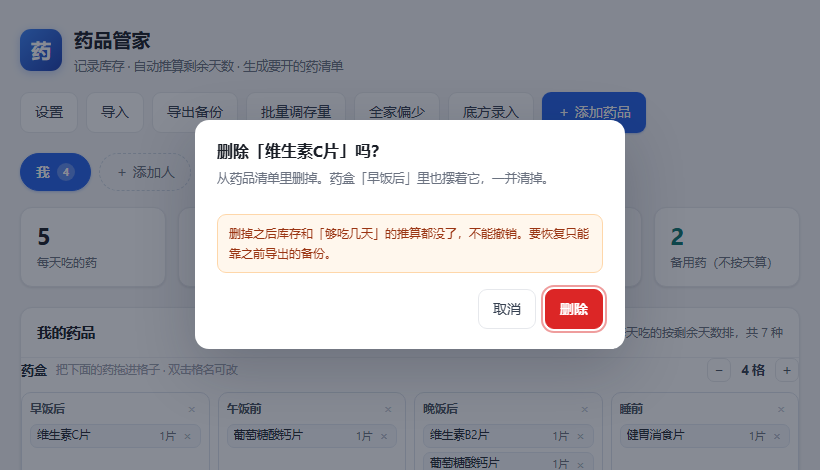

为什么不将就着用原生的：那个框是操作系统画的，写不了「这味药在药盒的『早饭后』里也摆着」这种话，
手机上还只在屏幕顶上闪一条、字小到看不清，而且它会**把整个页面卡住**。

三种形态，按事情的性质挑：

| 形态 | 长什么样 | 用在哪 |
|---|---|---|
| 确认 | 两个按钮：`取消` / `删除`（危险操作用**实心红**） | 删药、删人、减格子、整包恢复、覆盖导入 |
| 提示 | 一个按钮：`知道了` | 缺字段、没勾选、导入失败这类「看一眼就行」 |
| 输入 | 一个输入框 + `取消` / `改名` | 改格名、加成员 |

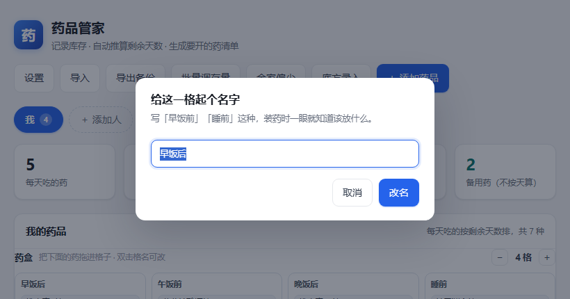

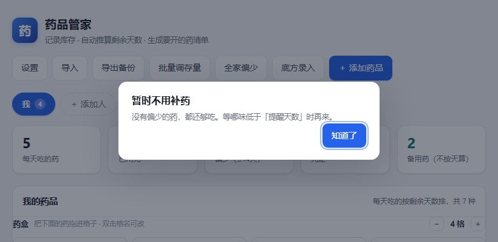

导入一份药品清单时还会多一种：这些药是**合并**进现有的，还是整批**覆盖**。
这不能用「确定 / 取消」表达 —— 取消本来就该是"什么都不做"，不能被借去当"覆盖"。
所以那里给三个按钮，各有各的字，点哪个就发生哪件事：

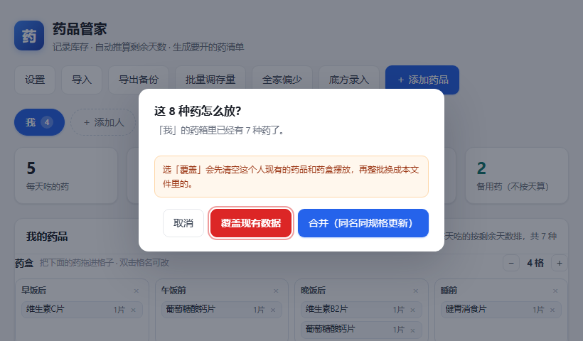

几条一致的规矩：

- **Esc、点框外、点「取消」都是一个意思** —— 什么都不做。不会出现「关了就当同意」。
- **回车 = 按主按钮**（改格名那种，手不用离开键盘）。
- **删除类的框会把连带影响写出来** —— 这味药在药盒哪几格里摆着、删了之后多久的推算会一起没。
  只说「确定删除吗」等于没说。
- 减格、覆盖导入这类**不是靠按钮颜色提醒，而是靠文字**：橙色那一块专门讲后果。

---

## 装成 Android App

`android/` 里是一个 WebView 壳：把**同一个** `index.html` 装进去，编出一个能直接装的 APK。
不需要 Android Studio，也不需要 gradle —— 一台有 JDK 的机器加 120MB 的 build-tools 就够。

```bash
python android/build.py
# → android/drug-keeper.apk   约 0.1 MB
```

壳里补了五件事（**只有装了 App 才走**，浏览器里整段不执行）：

| 壳里会发生什么 | 为什么会这样 | 壳里怎么办 |
|---|---|---|
| 点「导出备份」毫无反应 | WebView 不认 `blob:` + `a.download`，不报错也不下载 | 调 `AndroidApp.saveText()`，落进系统「下载」目录 |
| 「复制给医生」粘不出来 | `file://` 是不安全上下文，`navigator.clipboard` 根本不存在；退回的 `execCommand` 在壳里也常静默失败 | 调 `AndroidApp.copy()` 走系统剪贴板 |
| 点「导入」什么都不弹 | WebView 默认**不实现**文件选择 | `onShowFileChooser` + 系统文件选择器 |
| 按返回键直接退出 | 壳里没人管返回键 | 先当 Esc 关掉最上层弹窗，没弹窗了才退出 |
| 「打印」点了没反应 | WebView 没有打印服务 | 干脆把这个按钮藏掉（「下载 .txt」照常能用） |

**这个 App 不要任何权限** —— 连 `INTERNET` 都没有。页面、数据全在本机，
不联网也就谈不上把用药记录传出去。

> **数据不会自动搬过去**：网页版的 `localStorage` 和 App 里的**不是同一个源**。
> 换过去得先在网页上「导出备份」，装好 App 之后在「⋯ → 导入」里选那个 json。
> 反过来同理。以后想换手机也是这条路。

---

## 数据在哪

**只在你这台机器的浏览器里**（`localStorage`），不上传、不联网、没有服务器。
换电脑或清了浏览器数据就用「**导出备份**」的 JSON 文件，在新机器上「导入」还原。

也正因为如此：**这个程序不判断你该不该吃药、也不推荐药品**。
它只是把你告诉它的用量算成天数和份数。开什么药、开多少，是医生的事。

---

## 项目结构

```
index.html                程序本体：单文件，拷走就能跑
tools/rx_local/rx_local.py  可选的「本地解析」工具：Windows 自带 OCR 把处方照片读成药行（不联网、不上传照片）
_check/test_rxcap.py      自检脚本 —— 无头 Chrome 跑 334 项断言（口径、入库、文案、批量调存量、中间弹窗、底方解析、#rx= 链接跨实现往返、AI 说明与「页面不认照片 / 没有后台 AI」防回潮、真药名自查、「添加药品」必填口径、底方「是谁的」+ 重复药去重、底方「对账依据」必须可见、**一次原生弹窗都不许有**，以及「README 说的和事实一致」）
_check/test_prn.py        备用药那一类的自检 —— 91 条（每天吃 / 备用药分得开、备用药不按天扣、不进续方清单、不进批量调存量、表单必填口径两套、改类型时余量不被改写、导入导出 kind 不丢）
_check/test_box.py        药盒的自检 —— 191 条（默认 3 格、格数 1~7、**每一格自己的删除叉**（删指定那格 / 空格不问 / 只剩一格不给删 / 两个叉不串）、格名可改、**真把 PointerEvent 打进页面**验拖拽全链路、跨格是搬不是复制、未入清单的筛选与双向拖拽、摆药台连拖三次能摆满三格、药名折行的真实布局高度、备用药拖不进、删药清盒、按人分开、导出导入不丢、脏数据清洗、确认框真的弹/按钮真的能点/Esc 与点遮罩都算取消、以及那条"类名撞车"体检）
_check/test_all.py        全家汇总的自检 —— 74 条（只在人数 > 1 时出现且紧跟「＋ 添加人」、药名+单位合并口径、同名异单位不许相加、天数不一要如实写、**改总量后多的全给余量最少的那位（按天数不按片数）**、减药从余量最多的扣且不扣成负数、「余量最少」小标标的就是真会拿到药的人、备用药不参与分配、单人那行也能调、giveDelta 的边界、调完存盘、一个人时入口消失）
_check/test_rx_tpl.py     底方「提示词」那条路的自检 —— 60 条（提示词该有的 7 个位置、**一个服药时段都不许出现**、复制按钮真把文本写进剪贴板、[药单开始]/[药单结束] 切段挡住寒暄与提醒、七个字段逐个认、老写法不崩、**服药时间只擦不解析**（「每日2次 睡前」仍是 2 次）、**入库后药盒一格都不动**、空盒也不建格、`#rx=` 链接带了 slots 同样无视）
_check/test_fam.py        全家偏少的自检 —— 50 条（筛选阈值、排除备用药与没填用法的、按人分组、已用完排最前、去这个药箱能切人、单人不写"1 个人"、空态、换人后数据不串、一键复制的文字与页面口径一致且真的进了剪贴板）
_check/test_rx_local.py   上面那个工具的纯函数自检 —— 67 项，不需要图片、不需要 OCR 语言包
android/                  Android 壳：WebView 里装**同一个** index.html，编成能装的 APK
android/build.py          编 APK 的脚本（aapt2 → javac → d8 → zipalign → apksigner，不用 gradle）
android/AndroidManifest.xml  清单：连 INTERNET 权限都没有
android/src/com/xiaotuji/drugkeeper/MainActivity.java  WebView + 返回键 + 剪贴板 + 写文件
android/make_icon.py     画 App 图标（PIL 生成，不是手放的图）
_check/test_app.py        Android 壳补丁的自检 —— 24 条（假造一个 window.AndroidApp，把「导出落盘 / 复制进剪贴板 / 返回键先关弹窗」这三条只有装了 App 才走的路真跑一遍；反面再验「没有 AndroidApp 时补丁整段不生效」）
_check/test_wiz.py        引导式填写的自检 —— 66 条（三张表各自几步、一打开只露一步、进度栏只有图形与段数、**点哪段跳哪段**、这一格没填对就不让过且是就地红字不是弹窗、**回车 = 下一步而不是提交整张表**、备用药跳过「开药限制」、只有一格时进度栏不出现、走完 8 步存下来的每个字段、以及"字段一个没少 / name 一个没改"）
_check/shot.py            重新生成 docs/ 里的截图（含 390×844 的手机版三张）
docs/                     README 用的截图（每张都在上面被引用；没有没人看的图）
LICENSE                   MIT，署名「人间小土鸡」
.gitignore                挡住 `.workbuddy/`、`__pycache__`、以及下面那个本机专用的名单
```

> `_check/_tmp_deny_names.txt`（真药名名单）**故意不在上面**：它被 `.gitignore` 挡住，
> 是本机自检用来扫「要发布的文件里有没有真药名」的——**写进断言就等于把它们发出去了**。
> 别人 clone 下来会自动跳过它，自检也照样跑。

改完程序想自己验一遍：

```bash
python _check/test_rxcap.py       # 网页本体：334 项
python _check/test_prn.py         # 备用药那一类：91 项
python _check/test_box.py         # 药盒 + 未入清单 + 摆药台 + 拖拽 + 折行 + 单格删除 + 弹窗：191 项
python _check/test_all.py         # 全家汇总（按药名合并 + 调总量补给余量最少的人）：74 项
python _check/test_app.py         # Android 壳补丁（导出/复制/返回键）：24 项
python _check/test_fam.py         # 全家偏少聚合页：50 项
python _check/test_rx_tpl.py      # 底方提示词 + 只擦不解析的服药时间：60 项
python _check/test_rx_local.py    # 本地解析工具：67 项（纯函数，跑得快）
python _check/test_wiz.py         # 引导式填写（一次只问一件事）：65 项
```

前者会用无头 Chrome 打开一份临时副本（数据由脚本临时注入，不会写回 `index.html`），
把 334 条断言的通过情况打印出来，退出码非 0 就是有回归。
其中几条是**校验这份 README 自己**的：引用到的截图都在、`docs/` 里没有没人引用的孤儿图、
「项目结构」里列的每一项都存在、以及**上面写的断言条数和实际跑出来的一致**
（这条是自指的，所以你要是加了断言却忘了改上面那行数字，它会当场红）。

> 网页自检里有一类坑值得单独记住：`dialog.close()` 派发 `close` 事件是**排队**的，
> 而且它走 "DOM manipulation" 任务源、`setTimeout` 走定时器任务源，**两者之间没有先后保证**——
> 等 0ms 曾经偶发翻车（读到没重画的旧 DOM）。要断言「关窗后 DOM 该变了」，给足时间（50ms）。

> 程序内**没有内置示例数据**，打开就是空药箱 —— 示例数据里带着病情描述，不该跟着代码分发。
>
> 同一件事还有一道**药名关**：`_check/_tmp_deny_names.txt` 是**本机专用、不进仓库**的一份
> 真实药名名单（被 `.gitignore` 挡着）。自检会拿它扫 `index.html` / `README.md` / `_check/*.py`，
> 扫到任何一条就报 FAIL —— 防止以后顺手把一段真处方原文粘进示例或测试夹具。
> 这份名单不跟着仓库走，clone 下来的人会自动跳过这条。

---

## 浏览器要求

任意现代浏览器（Chrome / Edge / Safari / 手机自带浏览器都行）。
不需要联网、不需要装任何东西。手机上可以用「添加到主屏幕」当 App 用。

---

## 许可

MIT（见 [LICENSE](LICENSE)）。
